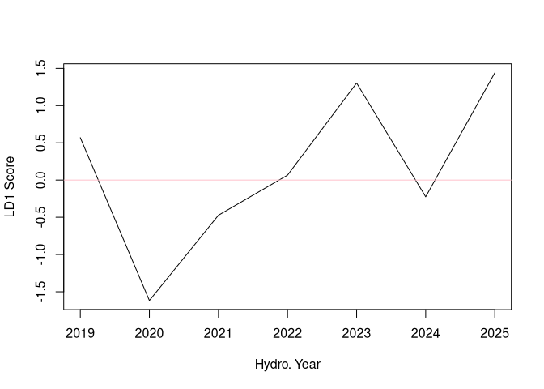
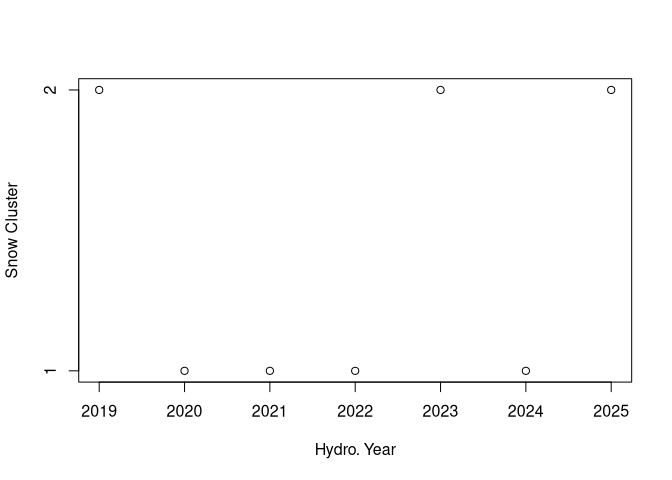

<!-- Add a project state badge
See https://github.com/BCDevExchange/Our-Project-Docs/blob/master/discussion/projectstates.md
If you have bcgovr installed and you use RStudio, click the 'Insert BCDevex Badge' Addin. -->

# MD10A1_MSLP_LDA

### Usage

This repository contains the scripts used in the analysis
*Classification of Clustered Snow Off Dates Over British Columbia,
Canada, from Mean Sea Level Pressure* (Gleason et al., 2020). In
addition, a Docker image is provided for enabling annual predictions of
the BC Snow Off Clusters.

There are 7 core scripts that are required for the analysis, they need
to be run in order:

-   DL_Fall_ERA5_MSLP.py
-   1_SDOFF_CLUSTER.R
-   2_FALL_ERA5_PCA.R
-   3_SDOFF_MSLP_LDA.R
-   4_TeleCorr.R
-   DL_Fall_ERA5_MSLP_annual.py
-   5_MAKE_LDA_PREDICTION.R

Note these scripts are provided for transparency, the data required to
run them is not hosted on this repository because of storage
constraints, however, we would be happy to provide these data by
request. Please see section below about how to make annual predictions.

#### Making a Annual Prediction, A Example

First, the users Climate Data Store Application Program Interface
credentials (.cdsapirc) file must be copied into a directory named
*userdata* on the users local machine, e.g., for Windows users:

``` bash
cd C:/Users/user/Desktop
mkdir userdata
cd userdata
cp C:/Users/user/.cdsapirc .
```

See <https://cds.climate.copernicus.eu/how-to-api> for more up to date
information.

With credentials in place, the DL_Fall_ERA5_MSLP_annual.py script should
be run from the *Data* directory to download annual ERA5 mean sea level
pressure GRIB files, adding the hydrologic year to download as an
argument, e.g., to run for 2022:

``` bash
python DL_Fall_ERA5_MSLP_annual.py 2022
```

Upon completion, the fall ERA5 mean sea level pressure GRIB file and
should appear in the *Data* directory as *YEAR_fall_era5_download.grib*,
where *YEAR* indicates the hydrologic year. This can take some time
depending on how busy the Copernicus server is.

To compute the atmospheric principle components, and make a prediction
of the snow duration cluster, run the *5_MAKE_LDA_PREDICTION.R* script.
The script will promt you to provide the local path to the cloned
MD10A1_MSLP_LDA directory on your machine and the hydrologic year you
wish to make a prediction for. The ERA5 sea level pressure GRIB for the
given year must be in the *Data* directory and named as specified above
or the script will fail. The computed MSLP principle components, LD1
score, posteriors, and predicted snow cluster are printed to the
console.

#### Past Predictions

| Year | PC1_score | PC2_score | PC3_score | PC8_score | PC10_score | PC11_score | LD1_score | LD1_C1_post | LD2_C2_post | clust |
|---:|------:|------:|------:|------:|-------:|-------:|------:|-------:|-------:|----:|
| 2019 | -130.06 | 343.25 | 133.02 | 30.07 | 157.86 | -80.60 | 0.569 | 0.215 | 0.785 | 2 |
| 2020 | 330.94 | -332.18 | 506.81 | -96.87 | 87.23 | 14.53 | -1.618 | 0.993 | 0.007 | 1 |
| 2021 | 733.39 | -389.21 | 46.30 | 170.27 | -89.08 | -9.28 | -0.472 | 0.840 | 0.160 | 1 |
| 2022 | 551.13 | -734.87 | 277.69 | 150.98 | -44.06 | -23.44 | 0.066 | 0.532 | 0.468 | 1 |
| 2023 | -70.72 | -44.48 | 466.48 | 67.78 | -122.88 | -152.90 | 1.303 | 0.033 | 0.967 | 2 |
| 2024 | 265.81 | -110.14 | 153.43 | 117.64 | -15.92 | 99.30 | -0.225 | 0.723 | 0.277 | 1 |
| 2025 | 73.26 | 245.97 | 69.96 | 221.01 | -86.78 | -89.81 | 1.439 | 0.023 | 0.977 | 2 |



### Project Status

[](https://github.com/bcgov/repomountie/blob/master/doc/lifecycle-badges.md)

### Getting Help or Reporting an Issue

To report bugs/issues/feature requests, please file an
[issue](https://github.com/bcgov/MD10A1_MSLP_LDA/issues/).

### How to Contribute

If you would like to contribute, please see our
[CONTRIBUTING](CONTRIBUTING.md) guidelines.

Please note that this project is released with a [Contributor Code of
Conduct](CODE_OF_CONDUCT.md). By participating in this project you agree
to abide by its terms.

### License

    Copyright 2021 Province of British Columbia

    Licensed under the Apache License, Version 2.0 (the &quot;License&quot;);
    you may not use this file except in compliance with the License.
    You may obtain a copy of the License at

    http://www.apache.org/licenses/LICENSE-2.0

    Unless required by applicable law or agreed to in writing, software distributed under the License is distributed on an &quot;AS IS&quot; BASIS,
    WITHOUT WARRANTIES OR CONDITIONS OF ANY KIND, either express or implied.
    See the License for the specific language governing permissions and limitations under the License.

------------------------------------------------------------------------

*This project was created using the
[bcgovr](https://github.com/bcgov/bcgovr) package.*
